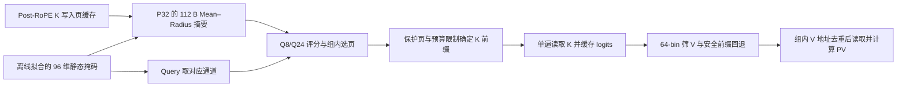

# CoMRAD 项目方案、实验结果与进展

**论文工作题目**  *CoMRAD — Compact Page Summaries for Sparse Attention in Edge LLM Decoding*

**方法全称**  Contribution-Pruned Mean–Radius Attention Decoding

**证据截至**  2026-11-27，覆盖 Round 14，实验发布提交为 `9979986`。 [实验发布提交](https://github.com/JesterZwd/Sparse_attention/commit/99799861517860677c160b361a519b4e9053d4d6)

## 1. 论文主张

端侧 LLM 长上下文解码在紧预算下，需要先读遍页摘要，再从剩余预算中购买 K/V。摘要过宽会挤占真实证据页的预算，摘要过薄又会丢掉排序信息。CoMRAD 用**基于评分贡献的静态通道裁剪**，把每个 32-token 页的 Mean–Radius 摘要从 **144 B 缩到 112 B**，并把节省的带宽分给少量额外 K 页。在 **5% Attention 物理读上限**下，Qwen3 64K 和 Llama 32K／64K 的独立配对结果均显示，M 相对 INT4 Quest 同时提高 Multi-Value 分数并减少每解码步读量。 [Round 13 结案](https://github.com/JesterZwd/Sparse_attention/blob/8f0ca65e121b087a1d0ebd98332a45ae75ddfe28/results/round13_comrad/checkpoint.md) · [Llama 六档结果](https://github.com/JesterZwd/Sparse_attention/blob/8f0ca65e121b087a1d0ebd98332a45ae75ddfe28/results/round13_llama_budgets/README.md)

论文可以围绕三个贡献组织。

1. **贡献导向的紧凑页摘要。** 在每个模型上用 4 条拟合提示，按层与 KV 组统计 Mean–Radius 评分的通道贡献，冻结 Top-96 掩码，同一 KV 组的 Query 头共享掩码。保留通道沿用 **6-bit Mean + 2-bit Radius**。112 B 记录比全维摘要小 **22.22%**，每页评分通道数少 **25%**。 [通道裁剪消融](https://github.com/JesterZwd/Sparse_attention/blob/8f0ca65e121b087a1d0ebd98332a45ae75ddfe28/results/round10_summary_64k/checkpoint.md) · [摘要实现](https://github.com/JesterZwd/Sparse_attention/blob/8f0ca65e121b087a1d0ebd98332a45ae75ddfe28/gqa_probe/compact_summary.py)
2. **按物理字节分配省出的带宽。** 默认 M 档把 K 初选页数限制为 `min(C112, A144 + 4)`。`C112` 是 112 B 自身预算允许的初选页数，`A144` 是同预算下全维参考的初选页数。M 在增加证据页覆盖的同时限制 QK 工作量和 logits 容量。32K 省读档 B 使用 `min(C112, A144)`，让节省的摘要带宽留在账上。 [工作点定义](https://github.com/JesterZwd/Sparse_attention/blob/8f0ca65e121b087a1d0ebd98332a45ae75ddfe28/gqa_probe/round11_workpoints.py) · [B/M/C 对照](https://github.com/JesterZwd/Sparse_attention/blob/8f0ca65e121b087a1d0ebd98332a45ae75ddfe28/results/round11_workpoints/checkpoint.md)
3. **与定点评分前端协同设计。** Q8 Query 同时驱动 Mean 乘加和 Radius 移位加，Q24 系数在整数归约之后缩放。112 B 与 144 B 使用同边界四头前端完成反压对拍和同库综合，并把实际记录接收间隔和映射频率回填到有限缓冲模型。 [融合评分器](https://github.com/JesterZwd/Sparse_attention/blob/8f0ca65e121b087a1d0ebd98332a45ae75ddfe28/results/round9_fused_scorer/report/checkpoint.md) · [同边界前端](https://github.com/JesterZwd/Sparse_attention/blob/8f0ca65e121b087a1d0ebd98332a45ae75ddfe28/results/round13_comrad/hardware/README.md)

## 2. 数据通路与实验口径

页摘要在 Post-RoPE K 上计算。对每个保留维，均值记为 $\mu$，半径取相对均值的最大偏离。页分数由 $q^\top\mu$、$0.25\,|q|^\top r$ 和有效 token 数偏置 $\ln n$ 构成，两个点积共享 Attention 缩放。评分贡献统计使用校准 Query 的平均绝对幅值与页内 $|\mu|+0.25r$ 的乘积。各头将页分数归一化，组内按归一化权重之和排序。实际记录由 96 B 编码、两个 FP16 scale 与一个有效长度字节组成，按 16 B 对齐到 112 B。 [摘要与通道统计](https://github.com/JesterZwd/Sparse_attention/blob/8f0ca65e121b087a1d0ebd98332a45ae75ddfe28/gqa_probe/compact_summary.py) · [整数评分参考](https://github.com/JesterZwd/Sparse_attention/blob/8f0ca65e121b087a1d0ebd98332a45ae75ddfe28/gqa_probe/scorer_int.py)

QK/PV 读取全维 affine32 KV4。分配器先扣除摘要扫描与保护页的字节，再按 0.80 的 V 预留规划可选页。64-bin 生成逐头 V mask，物理读取按 KV 组取并集。触及预算时，回退到可负担的安全 K 前缀，用已缓存 logits 再做 64-bin。首轮已读 K 及其 QK 继续计费。约 2% 的上限衡量 **最终 K 前缀内 V 筛选所丢弃的注意力权重占比**。 [物理预算、读量与回退](https://github.com/JesterZwd/Sparse_attention/blob/8f0ca65e121b087a1d0ebd98332a45ae75ddfe28/gqa_probe/summary_decode.py)

- **预算分母**是同状态下 Dense affine32 KV4 的 Attention 读量。摘要、K/V 编码、量化元数据与 burst 对齐均计入。结果同时报告每步和每答案成本，生成长度用来解释两者的差异。 [实验协议](https://github.com/JesterZwd/Sparse_attention/blob/8f0ca65e121b087a1d0ebd98332a45ae75ddfe28/docs/round13-workstation.md)
- **对照**包括 Dense KV4、144 B 全维 Mean6+Radius2 参考 A，以及同一门控与预算口径的 INT4 Quest。Quest 对照采用 SPARTA 式算法口径，比较范围是 affine32 KV4 下的选页与 Token 门控。 [Round 13 方法定义](https://github.com/JesterZwd/Sparse_attention/blob/8f0ca65e121b087a1d0ebd98332a45ae75ddfe28/results/round13_comrad/checkpoint.md)
- **验收**使用分离的拟合、校准和独立测试，质量按题配对并报告 95% bootstrap 区间。提质门槛为至少 +1 pp、区间下界大于零、每步读量增加至多 1% 且零超限。保质省读门槛为区间下界至少 −1 pp、每步少读至少 5%、主算术计数下降且零超限。主算术计数由融合通道更新、QK 和 PV 构成。 [冻结门槛](https://github.com/JesterZwd/Sparse_attention/blob/8f0ca65e121b087a1d0ebd98332a45ae75ddfe28/gqa_probe/round13_comrad.py) · [分项成本](https://github.com/JesterZwd/Sparse_attention/blob/8f0ca65e121b087a1d0ebd98332a45ae75ddfe28/results/round13_comrad/cross_panel_quality_cost.csv)

## 3. 当前结果

### 3.1 5% 主比较

各行来自各自的 64 条独立 Multi-Value 提示，统计量为官方分。最后两列为 M 相对同批 INT4 Quest 的配对改善。

| 模型／上下文 | Dense KV4 | INT4 Quest | 144 B A | 112 B M | M − Quest，95% 区间 | M 每步读量变化 |
|---|---:|---:|---:|---:|---:|---:|
| Qwen3-4B／64K | 98.83% | 84.38% | 92.58% | **91.80%** | **+7.42 pp** [+2.73, +11.72] | **−8.94%** |
| Llama-3.1-8B／32K | 99.61% | 48.83% | 67.58% | **74.61%** | **+25.78 pp** [+16.80, +34.77] | **−6.81%** |
| Llama-3.1-8B／64K | 95.31% | 54.69% | 67.97% | **71.09%** | **+16.41 pp** [+9.38, +23.44] | **−9.45%** |

M 相对全维 A 的提升取决于模型和样本。Llama 32K 提高 **7.03 pp**，区间 **[+2.73, +12.11] pp**，每步少读 **8.29%**。Llama 64K 和 Qwen3 64K 分别少读 **11.71%**，但两批样本的质量区间下界分别为 **−1.95 pp** 和 **−2.73 pp**，均低于 −1 pp 非劣门槛。 [Qwen3 配对结果](https://github.com/JesterZwd/Sparse_attention/blob/8f0ca65e121b087a1d0ebd98332a45ae75ddfe28/results/round13_comrad/qwen3_64k_multivalue/test/paired.json) · [Llama 32K 配对](https://github.com/JesterZwd/Sparse_attention/blob/8f0ca65e121b087a1d0ebd98332a45ae75ddfe28/results/round13_llama_budgets/32k/test/paired.json) · [Llama 64K 配对](https://github.com/JesterZwd/Sparse_attention/blob/8f0ca65e121b087a1d0ebd98332a45ae75ddfe28/results/round13_llama_budgets/64k/test/paired.json)

### 3.2 Qwen3 的提质档与省读档

Round 11 用统一的 0.80 V 预留验证了省出的带宽有两种用法。每行比较同批提示，读量和主算术变化均相对 A。

| 上下文／工作点 | 独立提示 | A → 候选官方分 | 分差，95% 配对区间 | 每步读量 | 主算术计数 |
|---|---:|---:|---:|---:|---:|
| 32K／B 限 K | 128 | 89.26% → 90.63% | +1.37 pp [−0.39, +3.12] | −14.45% | −12.99% |
| 32K／M 加 4 页 | 128 | 89.26% → 91.99% | +2.73 pp [+1.17, +4.49] | −8.70% | −5.62% |
| 64K／M 加 4 页 | 64 | 88.67% → 92.19% | +3.52 pp [+0.78, +6.25] | −11.75% | −9.63% |

32K B 通过非劣验收。M 将部分摘要节省换成额外 K，QK/PV 增加的同时主算术计数仍下降。Qwen3 64K 两批均少读约 11.7%，M 的官方分分别为 92.19% 和 91.80%，相对 A 的配对分差分别为 +3.52 pp 和 −0.78 pp。论文并列报告两批及各自区间。如需合并为 128 题的补充结果，先核对样本无重叠及运行口径一致，再按批次分层对提示配对重采样。Round 13 的 Quest 结果使用其已配对的 64 题。 [Round 11 端到端工作点](https://github.com/JesterZwd/Sparse_attention/blob/8f0ca65e121b087a1d0ebd98332a45ae75ddfe28/results/round11_workpoints/checkpoint.md) · [Round 13 新独立批次](https://github.com/JesterZwd/Sparse_attention/blob/8f0ca65e121b087a1d0ebd98332a45ae75ddfe28/results/round13_comrad/qwen3_64k_multivalue/test/paired.json)

### 3.3 Llama 预算曲线

三个预算均已有同批 **INT4 Quest、144 B A、112 B M** 数据。每格为官方分／每解码步物理读量。同一长度的三个预算使用同一批提示和同一份 CoMRAD 掩码。

| 上下文 | 预算 | INT4 Quest | 144 B A | 112 B M |
|---|---:|---:|---:|---:|
| 32K | 5% | 48.83%／55.55 MB | 67.58%／56.45 MB | 74.61%／51.77 MB |
| 32K | 7% | 79.30%／72.92 MB | 88.28%／75.46 MB | 89.45%／70.73 MB |
| 32K | 10% | 92.19%／99.98 MB | 94.53%／103.97 MB | 94.14%／99.32 MB |
| 64K | 5% | 54.69%／111.12 MB | 67.97%／113.96 MB | 71.09%／100.61 MB |
| 64K | 7% | 82.03%／146.64 MB | 80.47%／152.24 MB | 82.81%／139.27 MB |
| 64K | 10% | 88.67%／201.55 MB | 90.23%／210.65 MB | 89.84%／197.45 MB |

5% 升至 7% 时，M 在 32K、64K 分别提高 **14.84 pp** 和 **11.72 pp**。64K 从 7% 到 10% 再提高 **7.03 pp**，配对区间 **[+3.52, +10.94] pp**。10% 时两种长度的 M 均距 Dense KV4 **5.47 pp**。两长度各 16 题 Dense 校准中 BF16 与 KV4 均为 100%。六档独立测试合计 **11,995,904 个稀疏组步零超限**。 [逐预算成本](https://github.com/JesterZwd/Sparse_attention/blob/8f0ca65e121b087a1d0ebd98332a45ae75ddfe28/results/round13_llama_budgets/quality_cost.csv) · [验收复算](https://github.com/JesterZwd/Sparse_attention/blob/8f0ca65e121b087a1d0ebd98332a45ae75ddfe28/results/round13_llama_budgets/reproduction/accept-llama-matrix.log)

### 3.4 跨任务与模型适用范围

| Qwen3 独立面板，各 64 题 | Dense KV4 | INT4 Quest | 144 B A | 112 B M | M 相对 A 每步读量 |
|---|---:|---:|---:|---:|---:|
| 32K FWE 词频提取 | 91.15% | 89.06% | 89.58% | **90.10%** | **−8.73%** |
| LongBench v2，16K–32K | 31.25% | 34.38% | 32.81% | **32.81%** | **−7.68%** |

两项均通过 M 相对 A 的保质省读门槛。LongBench v2 的 M 与 A 逐题同分，保留 Dense KV4 答对的 **20/20** 题。两项相对 Quest 的质量优势均未建立。Round 13 主队列的四个独立面板合计 **9,274,080 个稀疏组步零超限**，其中包含 Qwen2.5 的量化失效面板。 [跨面板汇总与验收](https://github.com/JesterZwd/Sparse_attention/blob/8f0ca65e121b087a1d0ebd98332a45ae75ddfe28/results/round13_comrad/checkpoint.md)

**Qwen2.5-7B 是当前量化配置的边界。** 32K Multi-Value 16 题中，Dense BF16 为 **93.75%**，Dense affine32 KV4 为 **0%**。K4 隔离复测复现崩塌，缩短 K 分组至 16 维也未恢复。保留 32 维分组、改为 K8/V4 后，原 16 条 Multi-Value 和新 4 条 FWE 校准样本均与 BF16 逐题同分。当前 5% 跨家族主张采用 Qwen3 与 Llama，Qwen2.5 的混合精度后续需要独立核算 K 页和预算。 [Qwen2.5 诊断](https://github.com/JesterZwd/Sparse_attention/blob/8f0ca65e121b087a1d0ebd98332a45ae75ddfe28/results/round13_comrad/qwen25_diagnostic/README.md)

### 3.5 定点 Attention 闭环校准

Round 14 在 A800 上用 **52 条校准提示**运行 112 B M 的浮点后端参考和两条定点候选。三条路线共享冻结掩码、5% 物理读上限、0.80 V 预留及 M 配额。定点候选接入 Light-A1 页评分归一化、INT8 Query 与 affine32 K4 的整数 QK、定点 logits 和 64-bin，以及带 V scale/ZP 的 PV。稠密 prefill 和模型投影沿用 BF16。 [Round 14 报告](https://github.com/JesterZwd/Sparse_attention/blob/99799861517860677c160b361a519b4e9053d4d6/results/round14_fixed_backend/README.md) · [定点参考实现](https://github.com/JesterZwd/Sparse_attention/blob/99799861517860677c160b361a519b4e9053d4d6/results/round14_fixed_backend/reproduction/fixed_backend.py)

| 校准面板 | 提示数 | 浮点后端 M | UINT8 Block-Max | UINT16 |
|---|---:|---:|---:|---:|
| Qwen3 32K FWE | 8 | 91.67% | 91.67%（0.00 pp） | 91.67%（0.00 pp） |
| Qwen3 32K Multi-Value | 16 | 92.19% | 93.75%（+1.56 pp） | 95.31%（+3.13 pp） |
| Qwen3 64K Multi-Value | 12 | 95.83% | 93.75%（−2.08 pp） | 93.75%（−2.08 pp） |
| Llama 3.1 32K Multi-Value | 16 | 79.69% | 75.00%（−4.69 pp） | 82.81%（+3.13 pp） |

两条路线编码的都是 PV 使用的 **softmax 归一化前指数权重 P**，PV 累加后再除以权重和。UINT8 为每个头、每个页单独取最大值定标，UINT16 在每个头内使用跨页统一尺度。校准同时改变了位宽与缩放方式。八个定点配置合计 **1,259,232 个组步**，物理读量零超限，logits 零饱和。两档在 Qwen3 64K 上的分差均略低于 **−2 pp** 校准门槛。Llama 32K 的 UINT16 分差区间为 **[−4.69, +10.94] pp**，目前将其作为优先验证的后端候选。 [校准分数、配对区间与成本](https://github.com/JesterZwd/Sparse_attention/blob/99799861517860677c160b361a519b4e9053d4d6/results/round14_fixed_backend/calibration_summary.csv)

## 4. 主方案如何定型

| 阶段 | 关键证据 | 设计决定 |
|---|---|---|
| Round 8 | 相邻 Token 的固定 2→1 联合均值压缩将绝对输出误差 P99 从 4.624 推至 5.214。混合目录也抵消了部分 KV 省读。 | 保留原始页内 KV 表示与 64-bin 门控。 [报告](https://github.com/JesterZwd/Sparse_attention/blob/8f0ca65e121b087a1d0ebd98332a45ae75ddfe28/results/round8_pagepack/report/checkpoint.md) |
| Round 9 | Qwen3 32K、5% 下，144 B Mean6+Radius2 在 128 条独立提示上得 89.45%，同档 Quest 得 80.08%，分差 +9.38 pp、区间 [+5.66, +13.28] pp，每步读量仅差 0.51%。 | 确定 Mean–Radius 是有独立证据的摘要起点。 [报告](https://github.com/JesterZwd/Sparse_attention/blob/8f0ca65e121b087a1d0ebd98332a45ae75ddfe28/results/round9_fused_scorer/report/checkpoint.md) |
| Round 10 | 同取 24 页时，96 维贡献裁剪基本保留摘要排序质量。按 5% 分配时，可用摘要节省多读 K，独立官方分从 89.65% 到 92.97%。当时两路 V 预留不同。 | 将 112 B 推入统一预留的配对工作点实验。 [报告](https://github.com/JesterZwd/Sparse_attention/blob/8f0ca65e121b087a1d0ebd98332a45ae75ddfe28/results/round10_summary_64k/checkpoint.md) |
| Round 11 | 统一 0.80 V 预留后，32K B 相对 A 非劣且每步少读 14.45%。32K M 相对 A 提高 2.73 pp、每步少读 8.70%，64K M 提高 3.52 pp、每步少读 11.75%。32K C 的质量更高且模型时延上升。 | 冻结 M 为主工作点，B 为 32K 省读档，C 为质量优先对照。 [报告](https://github.com/JesterZwd/Sparse_attention/blob/8f0ca65e121b087a1d0ebd98332a45ae75ddfe28/results/round11_workpoints/checkpoint.md) |
| Round 12 | 80 维／96 B 的 32K 独立结果每步少读 7.99%，质量区间为 [−2.15, +0.59] pp。64K 校准下降 2.08 pp。 | 保留 96 维／112 B，窄摘要作为质量与读量权衡的消融。 [报告](https://github.com/JesterZwd/Sparse_attention/blob/8f0ca65e121b087a1d0ebd98332a45ae75ddfe28/results/round12_frontend/checkpoint.md) |
| Round 13 与 Llama 扩展 | 完成 Qwen3 64K 同批 Quest 对照、跨任务检验及 Llama 六档。Qwen2.5 的 K4 失效得到独立诊断。 | 将论文主结果集中在 5% 紧预算，7% 和 10% 用于展示质量曲线。 [结案](https://github.com/JesterZwd/Sparse_attention/blob/8f0ca65e121b087a1d0ebd98332a45ae75ddfe28/results/round13_comrad/checkpoint.md) · [Llama](https://github.com/JesterZwd/Sparse_attention/blob/8f0ca65e121b087a1d0ebd98332a45ae75ddfe28/results/round13_llama_budgets/README.md) |
| Round 14 | 完成四个定点校准面板、280 个向量的 CPU 复算和 24 个整步的同域回放。两种 P 编码均未通过 Qwen3 64K 的质量点估计门槛。 | 后端先验证 UINT16 配置，冻结位宽前定位 64K 掉点。以同域和分域回放作为集成后的比较口径。 [报告](https://github.com/JesterZwd/Sparse_attention/blob/99799861517860677c160b361a519b4e9053d4d6/results/round14_fixed_backend/README.md) |

## 5. 硬件进展与证据层级

### 5.1 前端 RTL 与同库映射

两路前端共用 **512 B 接收 FIFO、每拍双发系数、四头合组、同宽尾部乘加**。已完成实记录与合成输入的分数、标签和多 Query 对拍，覆盖随机停顿与长输出反压。同 Nangate45 约束下的 4 槽／3 结果信用配置如下。 [前端配置和验证](https://github.com/JesterZwd/Sparse_attention/blob/8f0ca65e121b087a1d0ebd98332a45ae75ddfe28/results/round13_comrad/hardware/README.md)

| 前端 | 持续接页间隔 | 映射临界周期 | 服务时间 | 映射面积 |
|---|---:|---:|---:|---:|
| 144 B A | 8.0 拍／记录 | 1.751 ns | 14.009 ns／记录 | 274,710 µm² |
| 112 B M | 6.5 拍／记录 | 1.745 ns | 11.345 ns／记录 | 248,653 µm² |
| M 相对 A | — | — | **−19.02%** | **−9.49%** |

上述时序为布线前 STA，两种映射均未达到 **1.25 ns** 目标。Round 9 单独的融合评分核在同吞吐下比双串行 Mean–Radius 的面积少 **30.60%**，门级切换计数少 **20.35%**。该核相对 Quest 小核面积多 **48.44%**。这两组比较对应不同模块边界。 [前端映射表](https://github.com/JesterZwd/Sparse_attention/blob/8f0ca65e121b087a1d0ebd98332a45ae75ddfe28/results/round13_comrad/hardware/mapped_frontends.csv) · [评分小核对照](https://github.com/JesterZwd/Sparse_attention/blob/8f0ca65e121b087a1d0ebd98332a45ae75ddfe28/results/round9_fused_scorer/report/checkpoint.md)

### 5.2 同资源 Attention 回放

Qwen3 新增 32K 和 64K 各 5 个完整解码步，合并历史轨迹共 **24 个整步**。以相同 LPDDR 资源、64 lane、64 KiB 和有限 K 双缓冲建模，前端回填各自映射周期，后端采用 1.25 ns 的模型时基。K 双缓冲为两页、共 **4,864 B** 的纯 K 数据。 [回放假设](https://github.com/JesterZwd/Sparse_attention/blob/8f0ca65e121b087a1d0ebd98332a45ae75ddfe28/results/round13_comrad/replay/replay_receipt.json) · [缓冲口径](https://github.com/JesterZwd/Sparse_attention/blob/8f0ca65e121b087a1d0ebd98332a45ae75ddfe28/results/round8_pagepack/report/checkpoint.md)

| 新增轨迹 | 样本数 | A 平均 | M 平均 | M 相对 A | M 峰值模型 SRAM |
|---|---:|---:|---:|---:|---:|
| 32K | 5 步 | 10.503 ms | 10.174 ms | **−3.13%** | 39,704 B |
| 64K | 5 步 | 20.220 ms | 18.867 ms | **−6.69%** | 52,274 B |

四张时序和能耗 CSV 已用 CPU 重跑并逐字节核对。时序适用于抽样的 Attention 回放。Round 13 的能耗情景覆盖评分前端和 DRAM。前端实现证据目前来自 RTL 仿真和标准单元映射。 [回放结果](https://github.com/JesterZwd/Sparse_attention/blob/8f0ca65e121b087a1d0ebd98332a45ae75ddfe28/results/round13_comrad/replay/step_timing_summary.csv) · [能耗口径](https://github.com/JesterZwd/Sparse_attention/blob/8f0ca65e121b087a1d0ebd98332a45ae75ddfe28/results/round13_comrad/replay/replay_receipt.json) · [复跑核对](https://github.com/JesterZwd/Sparse_attention/blob/8f0ca65e121b087a1d0ebd98332a45ae75ddfe28/results/round13_comrad/reproduction/acceptance-replay.log)

### 5.3 同域时钟扫描

Round 14 在全部 **24 个** Qwen3 整步上回放，32K 13 步，64K 11 步。两条路线在同域配置下采用相同逻辑周期，保留内存接口 CDC、接收缓冲及结果信用，移除评分器结果跨入后端的 CDC 延迟。

| 时钟配置 | 32K A → M 平均时延 | M 相对 A | 64K A → M 平均时延 | M 相对 A |
|---|---:|---:|---:|---:|
| Round 13 分域参照 | 10.514 → 10.183 ms | −3.14% | 20.238 → 18.890 ms | −6.66% |
| 共同 1.80 ns | 11.976 → 11.842 ms | −1.12% | 22.901 → 21.765 ms | −4.96% |
| 共同 2.00 ns | 12.625 → 12.482 ms | −1.13% | 24.101 → 22.875 ms | −5.09% |

两种共同周期下 M 的平均时延和 P95 均低于 A，两路的绝对平均时延均高于原分域投影。该结果来自历史地址轨迹和设定周期。完整引擎的可达频率、时钟域和接口 FIFO 规格仍需由集成后的时序与反压验证决定。 [同域回放汇总](https://github.com/JesterZwd/Sparse_attention/blob/99799861517860677c160b361a519b4e9053d4d6/results/round14_fixed_backend/clock/clock_summary.csv) · [回放假设与来源](https://github.com/JesterZwd/Sparse_attention/blob/99799861517860677c160b361a519b4e9053d4d6/results/round14_fixed_backend/clock/receipt.json)

## 6. 当前阶段与后续验收

### 6.1 后端位宽和质量归因

1. **复用已经归档的激励。** 280 个向量已从输入在独立 NumPy 参考中逐位复算，覆盖 Light-A1、QK、64-bin、PV 和物理读量账本。采集轨迹没有自然回退，定向测试已覆盖安全前缀、保护页和已读 K 记账。原始激励保存在本地验收包，GitHub 收据保留逐向量 SHA256。 [向量验收](https://github.com/JesterZwd/Sparse_attention/blob/99799861517860677c160b361a519b4e9053d4d6/results/round14_fixed_backend/vector_acceptance.json) · [定向回退测试](https://github.com/JesterZwd/Sparse_attention/blob/99799861517860677c160b361a519b4e9053d4d6/results/round14_fixed_backend/reproduction/test_fixed_backend.py)
2. **排查 Qwen3 64K 的质量掉点。** 在可配对的状态下逐级检查页排序、整数 QK、64-bin 保留集合和 PV。先用本地向量比较同 logits、同 mask 的 PV 输出，再按需要补采浮点参考的共同状态，定位逐题生成开始分叉的阶段。分开比较位宽与缩放策略，在同一缩放方式下评估 UINT8 和 UINT16。保留同一 M 配额和物理读上限。
3. **验收候选后冻结格式。** 以 UINT16 为起始候选，在 64K 质量恢复到预设校准线内后，结合块内累加范围、无符号权重接入、归一化及实际服务间隔确认位宽。校准结果用于选型，论文定点质量需用事先冻结的独立评估验证。当前工作优先使用 CPU 做数值归因与离线验证，GPU 留给必要的闭环复测和新增共同状态采集。 [复现实验入口](https://github.com/JesterZwd/Sparse_attention/blob/99799861517860677c160b361a519b4e9053d4d6/results/round14_fixed_backend/README.md)

### 6.2 完整引擎的时钟域与 PPA

集成页摘要生成、前端 FIFO/信用、共享 logits、整数后端与 K 双缓冲。用已验收向量在 RTL 上验证逐级数值和地址账本，再以同工艺、同接口、同内存资源比较 A/M。根据完整 RTL 综合和布线后时序回填两种时钟域，用完整步的均值、P95、FIFO/SRAM 峰值与内存反压选择实现。同步补齐 SRAM 宏端口、端到端吞吐和功耗。 [现有同域与分域回放](https://github.com/JesterZwd/Sparse_attention/blob/99799861517860677c160b361a519b4e9053d4d6/results/round14_fixed_backend/clock/clock_summary.csv)
